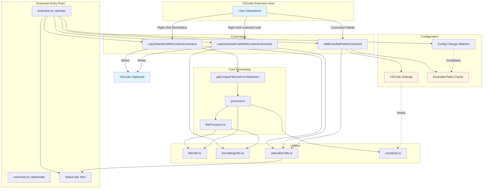

# Copy With Context - Overall Architecture

This diagram shows the high-level architecture of the VSCode extension and how the main components interact.

## Component Descriptions

### Extension Entry Point
- **extension.ts**: Manages extension lifecycle, registers commands, creates status bar, and sets up configuration watchers

### Commands
- **copySelectionWithContextCommand**: Copies selected files/folders from Explorer in markdown format
- **copySelectedCodeWithContextCommand**: Copies selected code from editor with file path and line numbers
- **editExcludedPathsCommand**: Interactive UI for managing excluded paths configuration

### Core Processing
- **fileProcessor.ts**: Processes individual files (type checking, size validation, content reading)
- **getUniqueFileUrisFromSelection**: Expands folders and deduplicates file URIs
- **processUri**: Processes individual file URIs

### Utilities
- **fileUtils.ts**: File operations (binary detection, reading, path handling)
- **formattingUtils.ts**: Markdown formatting logic
- **statusBarUtils.ts**: Status bar message handling
- **constants.ts**: Configuration management with caching

### Configuration
- **VSCode Settings**: User configuration storage
- **Excluded Paths Cache**: Performance optimization for frequently accessed settings
- **Config Change Watcher**: Invalidates cache when settings change
