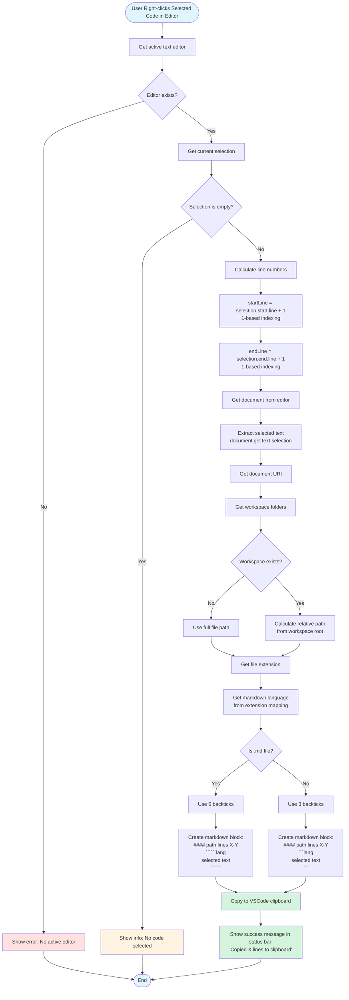

# Copy Selected Code with Context - Command Flow

This diagram shows the complete data flow and algorithm for the `copySelectedCodeWithContextCommand` which copies selected code from the active editor.



## Algorithm Steps

### Phase 1: Validation
1. **Get Active Editor**
   - Retrieve the currently active text editor from VSCode
   - If no editor is active → show error and exit
2. **Get Selection**
   - Retrieve the current text selection from the editor
   - If selection is empty (no text selected) → show info message and exit

### Phase 2: Line Number Calculation
1. **Extract Line Numbers**
   - Start line: `selection.start.line + 1` (convert from 0-based to 1-based)
   - End line: `selection.end.line + 1` (convert from 0-based to 1-based)
   - These will be displayed in the header for context

### Phase 3: Text Extraction
1. **Get Selected Text**
   - Use `document.getText(selection)` to extract the selected text
   - Preserves exact formatting, indentation, and newlines

### Phase 4: Path Calculation
1. **Get File Path**
   - Get document URI from editor
   - Check if file is in a workspace
   - **If in workspace**:
     - Calculate relative path from workspace root
     - Example: `src/commands.ts`
   - **If not in workspace**:
     - Use full absolute path
     - Example: `/Users/username/project/file.ts`

### Phase 5: Formatting
1. **Determine Language**
   - Extract file extension (e.g., `.ts`, `.py`, `.js`)
   - Look up markdown language identifier from mapping (100+ extensions supported)
   - Example: `.ts` → `typescript`, `.py` → `python`

2. **Create Markdown Block**
   - Header format: `#### <path> (lines <start>-<end>)`
   - **Normal files**: Use 3 backticks for code fence
   - **Markdown files**: Use 6 backticks to prevent conflicts with nested code blocks
   - Content: Selected text (no modifications)

### Phase 6: Output
1. **Copy to Clipboard**
   - Write formatted markdown to VSCode clipboard
2. **User Notification**
   - Show temporary status bar message: "Copied X lines to clipboard"
   - Message auto-hides after 5 seconds

## Output Format Example

### For TypeScript Code (lines 25-42)

```markdown
#### src/commands.ts (lines 25-42)
```typescript
export async function copySelectionWithContextCommand(
    _contextSelection: vscode.Uri | undefined,
    allSelections: vscode.Uri[] | undefined,
    statusBarItem: vscode.StatusBarItem
): Promise<void> {
    if (!allSelections || allSelections.length === 0) {
        vscode.window.showErrorMessage('No files selected');
        return;
    }
    // ... rest of the code
}
```
```

### For Markdown Code (lines 10-15)

```markdown
#### README.md (lines 10-15)
``````markdown
## Features

- Copy files with context
- Copy code with line numbers
- Exclude unwanted files
``````
```

## Key Features

### Context Preservation
- **Line numbers**: Shows exactly which lines were selected
- **File path**: Shows where the code came from
- **Relative paths**: Uses workspace-relative paths when possible for portability

### Markdown Compatibility
- **Syntax highlighting**: Automatically detects language from file extension
- **Nested code blocks**: Uses 6 backticks for markdown files to avoid conflicts
- **Exact formatting**: Preserves all indentation, spacing, and newlines

### User Experience
- **Instant feedback**: Status bar message shows immediately
- **Line count**: Shows how many lines were copied
- **Auto-hide**: Message disappears after 5 seconds
- **Error handling**: Clear messages for missing editor or empty selection

## Use Cases

This command is perfect for:
- Sharing code snippets in GitHub issues or PRs
- Creating documentation with code examples
- Asking LLM questions with specific code context
- Code reviews with precise line references
- Creating tutorials with numbered code sections
